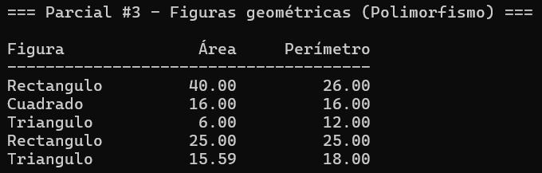
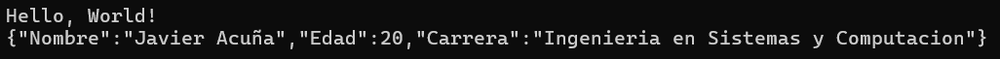
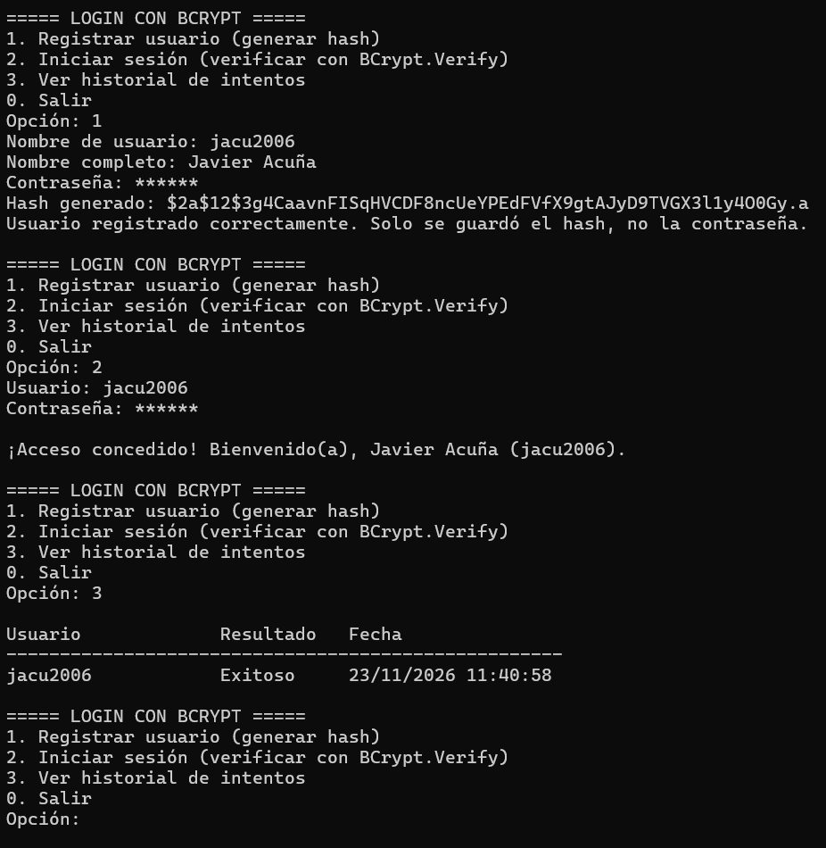
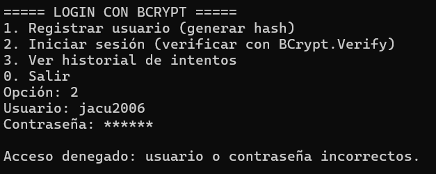
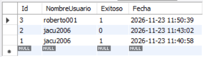
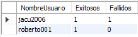

# Parcial #3 – Herramientas de la Programación Aplicada III (.NET)

**Fecha de entrega:** 23 de noviembre de 2026  
**Grupo:** 1IL133 · **II Semestre 2026**

---

## 📌 Contenido y propósito

Este repositorio contiene la parte práctica del Parcial #3. Reúne tres programas de consola en C# que aplican:

1. **Programación orientada a objetos:** una clase abstracta, herencia, un arreglo del tipo padre y polimorfismo.
2. **Serialización JSON** con la biblioteca `Newtonsoft.Json`.
3. **Seguridad de contraseñas:** un sistema de inicio de sesión que guarda únicamente el hash generado con BCrypt en una base de datos MySQL y registra cada intento de acceso para su análisis posterior.

**Arquitectura:** una solución de .NET (`Parcial3.sln`) con un proyecto de consola independiente para cada ejercicio. El ejercicio 3 se conecta a MySQL con ADO.NET (`MySql.Data`) y emplea consultas parametrizadas para prevenir la inyección SQL.

---

## 🛠️ Tecnologías

| Tecnología | Uso |
|---|---|
| C# / .NET 10 | Lenguaje y plataforma |
| Newtonsoft.Json | Serialización de objetos a JSON (ejercicio 2) |
| BCrypt.Net-Next | Generación y verificación de hashes de contraseñas (ejercicio 3) |
| MySQL 8.0 + MySql.Data | Base de datos del login (ejercicio 3) |
| Visual Studio 2026 | Entorno de desarrollo |
| Git y GitHub | Control de versiones |

---

## 👤 Autor

| | |
|---|---|
| **Estudiante** | Javier Acuña |
| **Institución** | Universidad Tecnológica de Panamá (UTP) |
| **Facultad** | Facultad de Ingeniería de Sistemas Computacionales |
| **Campus** | Víctor Levi Sasso |
| **Asignatura** | Herramientas de la Programación Aplicada III (.NET) |
| **Grupo** | 1IL133 |
| **Instructora** | Ing. Irina Fong |

---

## ✅ Problemas resueltos

### Ejercicio 1: Jerarquía de figuras con polimorfismo
- Clase abstracta `Figura` con los métodos abstractos `CalcularArea()` y `CalcularPerimetro()`.
- Clases derivadas `Rectangulo`, `Cuadrado` y `Triangulo` (el área del triángulo se calcula con la fórmula de Herón).
- Arreglo unidimensional `Figura[]` que almacena objetos de distintas clases hijas.
- Recorrido polimórfico con `foreach` que muestra el nombre de la clase, su área y su perímetro.

### Ejercicio 2: Trabajar con JSON usando Newtonsoft.Json
- Creación de un objeto con los datos de una persona y su conversión a una cadena JSON con `JsonConvert.SerializeObject()`.

### Ejercicio 3: Login con BCrypt y MySQL
- Registro de usuarios: se genera el hash con `BCrypt.HashPassword()` (factor de trabajo 12) y se guarda en la base de datos.
- Inicio de sesión: la contraseña se verifica con `BCrypt.Verify()`.
- Si el acceso es exitoso, se muestra el nombre completo del usuario.
- Cada intento, fallido o exitoso, se guarda en la tabla `IntentosLogin` con el usuario y la fecha.
- La contraseña se oculta con `*` al escribirla en consola.

---

## 📸 Capturas

### Ejercicio 1: Figuras


### Ejercicio 2: JSON


### Ejercicio 3: Login con BCrypt

#### Flujo Exitoso (Registro e Inicio de Sesión)


#### Acceso Denegado


#### Historial de Intentos en Consola


#### Resumen de Intentos por Usuario en MySQL


---

## 📁 Estructura de directorios

```text
Parcial3/
├── Parcial3.sln                        # Solución con los 3 proyectos
├── README.md
├── .gitignore
├── imgs/                               # Capturas de ejecución y base de datos
│   ├── ejercicio_1.png
│   ├── ejercicio_2.png
│   ├── ejercicio_3_acceso_denegado.png
│   ├── ejercicio_3_flujo_exitoso.png
│   ├── ejercicio_3_intentos.png
│   └── ejercicio_3_intentos_por_usuario.png
├── Ejercicio1_Figuras/
│   ├── Ejercicio1_Figuras.csproj
│   └── Program.cs                      # Figura, Rectangulo, Cuadrado, Triangulo y Main
├── Ejercicio2_Json/
│   ├── Ejercicio2_Json.csproj
│   └── Program.cs                      # Serialización con Newtonsoft.Json
└── Ejercicio3_LoginBCrypt/
    ├── Ejercicio3_LoginBCrypt.csproj
    ├── Program.cs                      # Login, registro e historial de intentos
    └── BaseDatos/
        ├── LoginBCrypt.sql             # Script de creación de la BD y sus tablas
        └── LoginBCrypt_Backup.sql      # Backup de la BD (estructura + datos) exportado desde MySQL Workbench
```

*(Nota: Los directorios de compilación `bin/`, `obj/` y archivos `.user` son ignorados automáticamente por `.gitignore`).*

### Base de datos `LoginBCrypt`

| Tabla | Columnas |
|---|---|
| `Usuarios` | `Id`, `NombreUsuario` (único), `NombreCompleto`, `PasswordHash`, `FechaCreacion` |
| `IntentosLogin` | `Id`, `NombreUsuario`, `Exitoso` (`1` = exitoso, `0` = fallido), `Fecha` |

---

## ▶️ Ejecución

**Requisitos:** .NET SDK 10 y MySQL Server 8.0.

```bash
git clone https://github.com/jacu2006/Parcial3.git
cd Parcial3
```

**Ejercicio 1**
```bash
cd Ejercicio1_Figuras
dotnet run
```

**Ejercicio 2**
```bash
cd Ejercicio2_Json
dotnet run
```

**Ejercicio 3**
1. Restaure la base de datos en MySQL Workbench con una de estas opciones:
   - **Desde cero:** ejecute `Ejercicio3_LoginBCrypt/BaseDatos/LoginBCrypt.sql` (crea la BD `LoginBCrypt` y sus tablas vacías).
   - **Con datos:** importe `Ejercicio3_LoginBCrypt/BaseDatos/LoginBCrypt_Backup.sql` mediante **Server → Data Import** (*Import from Self-Contained File*).
2. En `Program.cs`, verifique que la `CadenaConexion` coincida con sus credenciales locales de MySQL (`Uid=root;Pwd=demo`).
3. Ejecute el proyecto:
   ```bash
   cd Ejercicio3_LoginBCrypt
   dotnet run
   ```
4. Opción **1**: registrar un usuario. Opción **2**: iniciar sesión. Opción **3**: ver el historial de intentos.

**Consultas para revisar los intentos en MySQL:**
```sql
USE LoginBCrypt;

-- Historial completo
SELECT * FROM IntentosLogin ORDER BY Fecha DESC;

-- Resumen por usuario
SELECT NombreUsuario,
       SUM(CASE WHEN Exitoso = 1 THEN 1 ELSE 0 END) AS Exitosos,
       SUM(CASE WHEN Exitoso = 0 THEN 1 ELSE 0 END) AS Fallidos
FROM IntentosLogin
GROUP BY NombreUsuario;
```

---

## 📚 Referencias

- [Documentación de C# – Microsoft Learn](https://learn.microsoft.com/es-es/dotnet/csharp/)
- [Clases y miembros abstractos – Microsoft Learn](https://learn.microsoft.com/es-es/dotnet/csharp/language-reference/keywords/abstract)
- [Newtonsoft.Json – Documentación oficial](https://www.newtonsoft.com/json/help/html/Introduction.htm)
- [BCrypt.Net-Next – Repositorio en GitHub](https://github.com/BcryptNet/bcrypt.net)
- [MySQL Connector/NET – Documentación](https://dev.mysql.com/doc/connector-net/en/)
- [Sintaxis básica de Markdown – GitHub Docs](https://docs.github.com/es/get-started/writing-on-github/getting-started-with-writing-and-formatting-on-github/basic-writing-and-formatting-syntax)